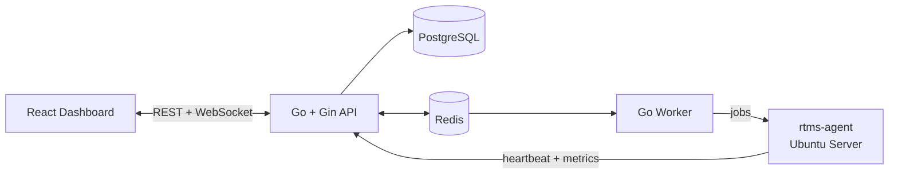

<div align="center">

# 📡 RTMS Monitoring

**Real-Time Monitoring Server** — a lightweight platform to monitor and manage Linux servers in real time through a Go agent.


</div>

---

## ✨ About

RTMS Monitoring is a full-stack server monitoring platform. A small agent runs on each Linux server, collects system metrics, and streams them to a central Go API. The web dashboard shows server health live, without refreshing the page.

It is also a hands-on project for exploring Go concurrency, real-time communication, background processing, and Linux service management.

## 🚀 Features

- 🖥️ **Server registration**: add servers and issue dedicated agent tokens
- 📊 **Real-time metrics**: CPU, memory, disk, load, and uptime streamed live
- 🟢 **Online / offline detection**: status driven by agent heartbeats
- 📈 **Historical charts**: view metrics over time
- ⚙️ **Remote jobs**: run predefined, allowlisted actions on a server
- 🔔 **Alerts**: threshold-based notifications
- 🔐 **Authentication and roles**: Admin and Viewer access
- 📝 **Audit log**: track every important action

## 🏗️ Architecture



## 🧰 Tech Stack

| Layer | Technology |
|---|---|
| **Frontend** | React, TypeScript, Vite, Tailwind CSS, TanStack Query, Recharts |
| **Backend** | Go, Gin, PostgreSQL, Redis, WebSocket |
| **Agent** | Go, Linux, systemd |
| **Infrastructure** | Ubuntu Server, Nginx, UFW, native deployment (no Docker) |

## 📁 Project Structure

```text
RTMServer_Monitoring/
├── frontend/   # React + TypeScript dashboard
├── backend/    # Go + Gin API server
└── agent/      # rtms-agent, runs on monitored servers
```

## 🗺️ Roadmap

| Phase | Scope | Status |
|---|---|---|
| 0 | Environment setup | ✅ |
| 1 | Go API foundation | 🚧 |
| 2 | PostgreSQL | ⏳ |
| 3 | Authentication | ⏳ |
| 4 | React dashboard | ⏳ |
| 5 | Go agent | ⏳ |
| 6 | Metrics & heartbeat | ⏳ |
| 7 | WebSocket real-time | ⏳ |
| 8 | Redis | ⏳ |
| 9 | Worker | ⏳ |
| 10 | Jobs | ⏳ |
| 11 | Alerts | ⏳ |

## 👤 Author

**Leon** · [@leonza26](https://github.com/leonza26)

<div align="center">

⭐ If you find this project interesting, feel free to give it a star!

</div>